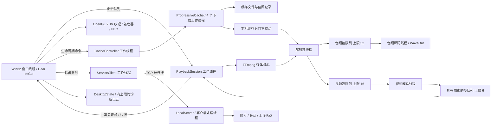
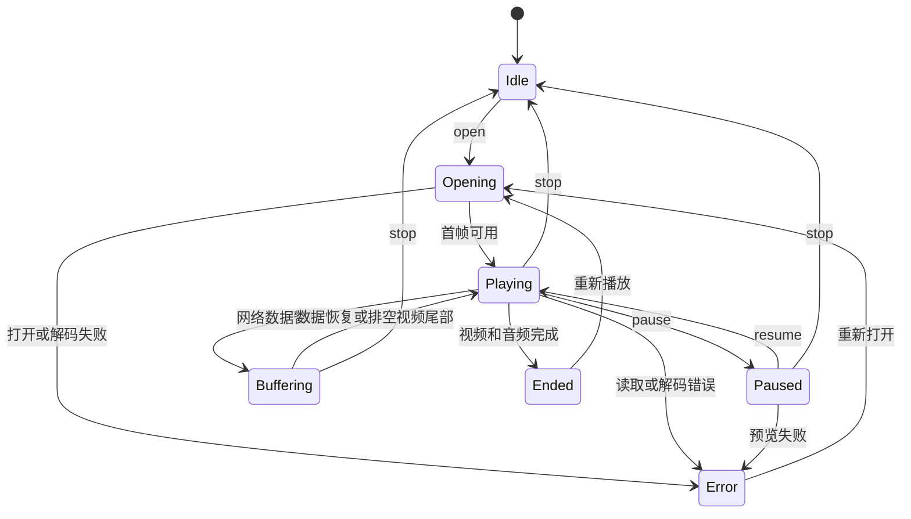
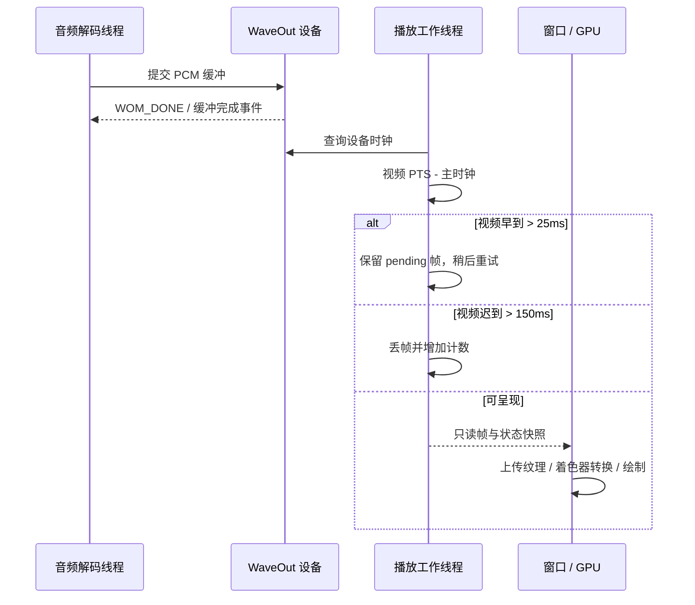
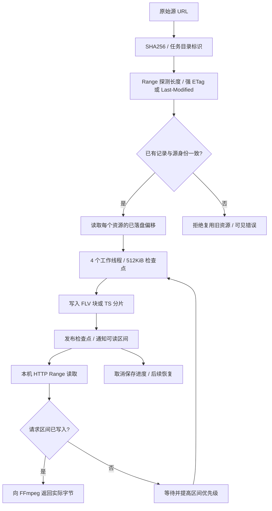
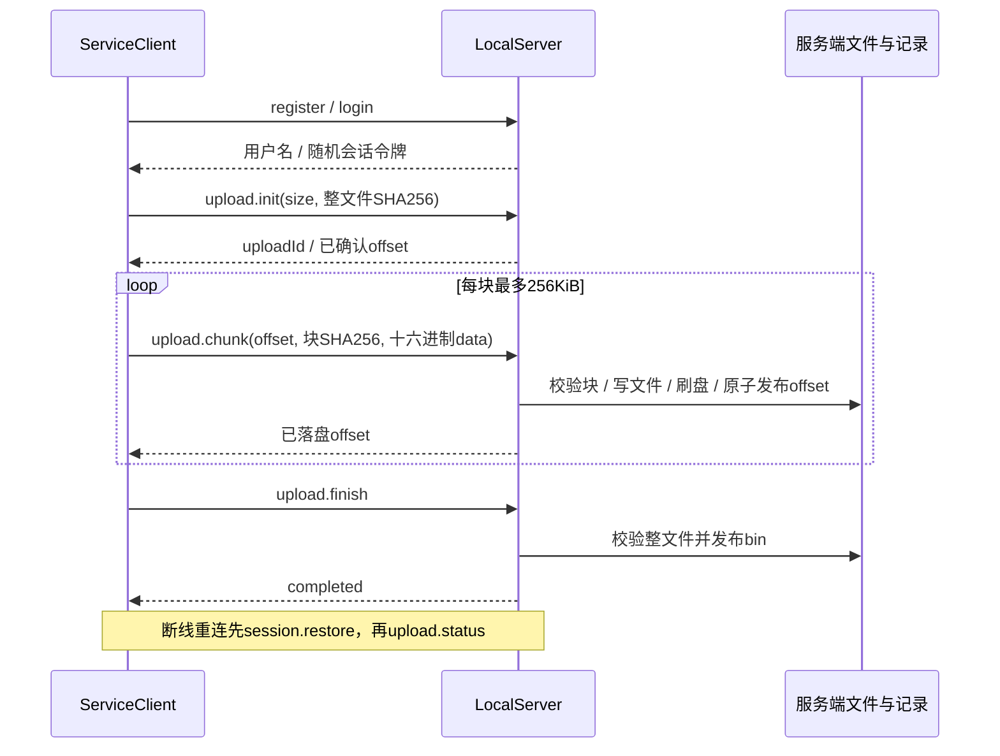

# 架构、线程与协议

应用使用 C++17、Win32、Dear ImGui、FFmpeg、OpenGL 和 Windows 音频／网络接口。桌面窗口线程负责事件、界面和 GPU 提交；媒体、缓存及账号传输在各自后台线程执行。当前媒体核心仍有单实例全局 FFmpeg 状态，不能把多个 `PlaybackSession` 并发实例当作受支持功能。

## 模块与线程边界

`PlaybackSession` 的命令队列用互斥锁和条件变量，序列化 open、pause、seek、stop、rate 和 volume。`snapshot()` 返回值拷贝，`frame()` 返回共享只读帧；发布时拷贝／转移拥有的像素、平面偏移、步长和色彩元数据，避免 UI 持有已经释放的解码缓冲。停止与打开命令参与取消检查，以中断耗时媒体读取。退出时通知停止并 join 所拥有线程。

音频包、视频包和帧队列都有容量限制和结束／停止标志；生产者在满队列等待，消费者释放容量后通知。窗口线程不直接等待网络分片或服务端上传确认。`CacheController` 将耗时的源探测、启动和取消移出窗口线程，并用 generation 防止旧任务结果覆盖新任务。

## 播放状态与音画同步

1× 有音频时，以 WaveOut 设备播放时钟为主。WOM_DONE 回调通知完成的音频缓冲区可复用；回调不是逐帧渲染线程。播放线程计算视频 PTS 减主时钟的差值：早到超过 25 ms 时等待，迟到超过 150 ms 时丢帧，其他情况发布当前帧。这是控制阈值，不能当作实测同步精度。无音频或非 1× 时使用视频时钟；非 1× 静音。

暂停跳转使用真实解码预览并发布新 serial；暂停帧的旋转、缩放和滤镜仍由 GPU 重绘。缓冲耗尽会暂停音频，恢复出帧后继续；尾部视频完成时让残余音频排空，再进入 Ended。默认 OpenGL 支持三平面 YUV 到 RGB、范围和矩阵信息，D3D11 保留兼容路径。MF 后端不代表已证明硬解，HDR 色调映射不在本轮。

## 缓存、检查点与恢复

HTTP FLV 与有限、未加密、单音轨 MPEG-TS HLS 点播是缓存范围。HLS 选择首个变体；不支持加密、fMP4、BYTERANGE、多音轨、直播缓存和 DRM。预分配文件的空洞不作为可播放内容，本机 HTTP 端点只暴露实际已写入区间。每个任务使用目录锁，另一写任务不能同时修改相同缓存。

取消下载保留检查点；重新开始同一源时核对长度和校验标识，再继续块／分片内部偏移。第二层进程强制终止验证记录了每个活跃工作块小于 1 MiB 的重下载量，证据见 [第二层记录](../validation/2026-10-13-second-layer.md)。它没有证明断电、磁盘损坏或外部改写时同样可靠。普通演示的随机端口改变 URL，跨窗口续传应保持独立固定源和原始媒体不变。

## 服务协议与上传确认

TCP 帧是四字节网络序长度加 UTF-8 JSON，正文限制为 1～2097152 字节。请求和响应包含 `version`、`id`、`op` 和 `body`；响应还含 `ok`、`code`。接收完整收集长度和正文，处理拆包／合包，错误长度或 JSON 关闭连接。客户端核对响应身份，单次请求共用五秒读写期限；空闲两秒心跳，断线以 1／2／4 秒间隔重连。

账号使用 16 字节随机盐、600000 次 PBKDF2-HMAC-SHA256 和 32 字节哈希。会话令牌使用 32 字节随机数。上传按账号隔离，以完整 SHA256 和 size 识别文件；重复相同偏移和字节幂等确认，冲突或错误偏移返回业务错误。服务重启丢弃超过已记录偏移的尾部；完成后整文件校验。详细字段、错误码和取消语义见 [协议 v1](../protocol/service-v1.md)。

服务只监听回环地址，并独占数据目录的 `.service.lock`；换端口不能绕过目录独占。账号／会话持久化属于本机演示存储，不包含 TLS、令牌过期和公网治理。UNAUTHORIZED 清除客户端身份；主动断开也清除身份，意外断线保留令牌用于恢复。

## 桌面状态与发布边界

第三层 `DesktopState` 接口验证类型、范围、数量和 JSON 大小；最近记录最多 10 条、下载最多 100 条、JSON 最多 1 MiB。未知字段不重新保存；非法或损坏状态回到默认值并返回诊断。合法保存原子替换，写失败保留旧记录；诊断日志限于 1 MiB，日志写失败在 UI 可见。密码和令牌不属于桌面状态字段。

最近项是直接可播放的地址，没有 `requiresSource` 字段；加载和保存时，只要去除 userinfo、查询或片段会改变网络 URL，就跳过整个最近项，包括签名／认证地址，避免持久化可点击的错误源。下载历史则保留脱敏记录，去除上述 URL 部分，并将 `requiresSource` 设为原有标记或地址发生变化。该标记只禁用直接恢复，要求用户重新输入完整 URL；`taskKey` 保留原始源 UTF-8 字节的 SHA256，允许清理签名历史而不保存凭据。`removeDesktopCacheByKey` 只接受恰好 64 位小写十六进制标识，沿用目录边界、reparse 和任务锁检查，不接受任意路径。旧脱敏记录若没有合法键，则清理也禁用。诊断日志去除 URL 凭据及查询内容。

UI 在启动时加载设置／最近／下载历史，在有意义的变更时保存，传输中心可打开缓存和诊断目录。所有历史项共用一个清理确认弹窗，显示所选源，并明确提示会停止当前播放与下载。确认后关闭缓存自动播放、停止当前播放器并取消当前下载，即使当前源与所选历史项不同；待播放 Idle 后在后台清理所选任务目录。选择“保留”或关闭弹窗取消操作。任务锁防止仍被其他实例占用的目录被删；目录规范化和 reparse 检查拒绝越界与链接。清理结果和日志／状态写入错误进入可见诊断。这些行为的最终构建回归仍以对应验证记录为准。

缓存删除成功后，UI 按所选 `taskKey` 删除历史记录，避免不同签名 URL 脱敏成同一地址后误删另一任务；没有键的旧普通记录才按完整源地址回退。刷新已有记录时保留原任务键，防止清理身份丢失。

加载错误使用独立的 `stateLoadError` 持续显示，后续保存成功不覆盖该诊断；用户通过“知道了”确认。保存错误与日志错误分别显示，保持可追溯的失败原因。

便携包以明确输入白名单复制三个 Release 程序、固定媒体、文档和实际安装许可证，不复制数据目录或开发工具。schemaVersion=3 的清单记录每个文件的 SHA256、大小和用途，清单本身由 ZIP 与验证报告的哈希标识。运行数据另写入包内或用户可写路径。验证程序分别检查暂存目录与 ZIP 解压目录，在源码目录外 cwd 和减少的 PATH 下运行真实窗口流程。该隔离仍使用本机 GPU、音频和 Windows DLL，不构成干净虚拟机验证。
