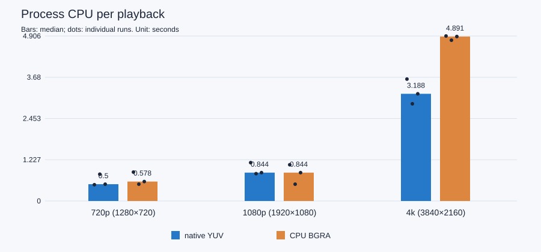
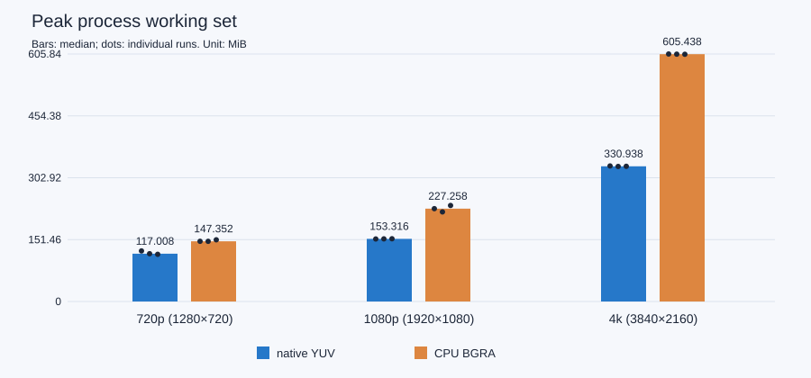

# 2026-10-13 实测摘要

这些 CSV、JSON 摘要和 SVG 来自 18 次真实 Release 性能采样：720p、1080p、4K，每种像素路径各三次。副本取自发布候选包，绝对工作区路径已经改为 `workspace/` 标签，数值未修改。完整环境与逐帧 raw JSON 随便携包提供，本机原始记录在 `build/third-layer/benchmark-results`。

CPU 对照必须同时检查相同素材、FFmpeg／OpenGL／swap 条件和完整帧账目。720p 中位 CPU 秒降低 13.514%，1080p 中位 CPU 秒相同；4K 三次出现 observer 漏见，保留观察值并标记 inconclusive，不计算提升百分比。背景小视频音频长测、短素材、三次重复和一次测量中断限制外推。

详细定义、实际机器、素材哈希和中断来源见 [性能方法](../method.md)，整体验证见 [第三层记录](../../validation/2026-10-13-third-layer.md)。

